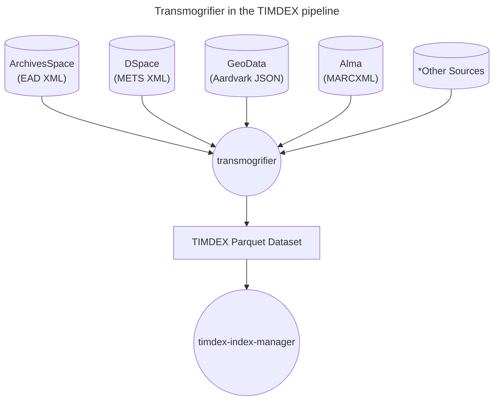

# transmogrifier

An application to transform source records to the TIMDEX data model to facilitate ingest into an OpenSearch index.

TIMDEX ingests records from various sources with different metadata formats, necessitating an application to transform those source records to a common metadata format, the TIMDEX data model in this case. This application processes source records, creates records formatted according to the TIMDEX data model, and writes to a TIMDEX parquet dataset. 



The TIMDEX data model is designed to produce records that can be successfully ingested into an OpenSearch index and contains data fields that are broadly applicable to various types of records. `transmogrifier` contains different validators to ensure that the record is structured properly and that certain types of values, such as dates, align with OpenSearch's expectations.

Each source is defined with configuration values and a dedicated transform class to process records from that source. For each transform class, various errors and warnings are logged. Some errors are logged and the entire source record is skipped because the severity implies it should not be processed until fixed, while others are merely logged as warnings for later review. The application also determines which records are marked as deleted in each source and removes those record from the OpenSearch index. 

After Transmogrifier writes the transformed files to the TIMDEX parquet dataset, it is processed by `timdex-index-manager` for ingest into an OpenSearch index.

## Development

- To preview a list of available Makefile commands: `make help`
- To install with dev dependencies: `make install`
- To update dependencies: `make update`
- To run unit tests: `make test`
- To lint the repo: `make lint`
- To auto-fix formatting and supported lint issues: `make lint-fix`
- To scan dependencies for vulnerabilities: `make security`
- To view CLI usage: `uv run transform --help`

## Environment Variables

### Required 

```shell
SENTRY_DSN=### If set to a valid Sentry DSN, enables Sentry exception monitoring. This is not needed for local development.
STATUS_UPDATE_INTERVAL=### The transform process logs the # of records transformed every nth record (1000 by default). Set this env variable to any integer to change the frequency of logging status updates. Can be useful for developm ent/debugging.
WORKSPACE=### Set to `dev` for local development, this will be set to `stage` and `prod` in those environments by Terraform.
```

### Optional

```shell
WARNING_ONLY_LOGGERS=### Comma-seperated list of logger names to set as WARNING only, e.g. 'botocore,charset_normalizer,smart_open'
LIBGUIDES_API_TOKEN=### Libguides API token [required for libguides source]
LIBGUIDES_CLIENT_ID=### Libguides account id [required for libguides source] 
TIMDEX_DATASET_LOCATION=### Location of the TIMDEX dataset 
```

## CLI commands

### `transform`

Exactly one input option and exactly one output option are required.

| Input | Reads |
|---|---|
| `--input-file` | A source file of extracted records; run data is parsed from the filename. |
| `--input-dataset` | Current source records from a TIMDEX dataset, as a `patch` run. |
| `--input-parquet` | Source records from a parquet file or directory as a `patch` run. Only rows for `--source` with action `index` are read. |

| Output | Writes |
|---|---|
| `--output-file` | Transformed records with action `index` to a JSONLines file, one per line. Useful for debugging. |
| `--output-dataset` | All records to a TIMDEX dataset. |
| `--output-parquet` | All records to parquet files. |

Source records are stored in the output as they were read: the bytes of each XML `<record>` element (as serialized by lxml), each JSONLines line, or the `source_record` of each dataset or parquet row.

#### Workers and performance

`--workers N` transforms records in `N` worker processes. The main process reads source records and writes output; workers parse and transform. Records are handled in input order, so output is identical for any number of workers. The default, `1`, transforms in the main process.

Workers help most for sources with slow, CPU-bound transforms. Each worker uses roughly 0.5 GB of memory. JSON sources are already fast, and may not benefit.

```text
Usage: transform [OPTIONS]

Options:
  -s, --source [alma|aspace|digitalcollections|dspace|jpal|libguides|mitlibwebsite|gismit|gisogm|researchdatabases|whoas|zenodo]
                                  Source records were harvested from, must
                                  choose from list of options  [required]
  -i, --input-file TEXT           Filepath of input records to transform.  The
                                  filename must be in the format
                                  <source>-<YYYY-MM-DD>-<run-type>-extracted-
                                  records-
                                  to-<action><index[optional]>.<extension>.
                                  Examples: 'gisogm-2024-03-28-daily-
                                  extracted-records-to-index.jsonl' or
                                  'alma-2023-01-13-full-extracted-records-to-
                                  index_17.xml'.
  -id, --input-dataset TEXT       Location of TIMDEX parquet dataset with
                                  source records used as input.
  -ip, --input-parquet TEXT       Location of a parquet file, or directory of
                                  parquet files, with source records used as
                                  input, e.g. a Timmy export.
  -of, --output-file TEXT         Filepath (local or S3) of a JSONLines file
                                  to write transformed records to, one per
                                  line.  Only records with action 'index' are
                                  written.
  -o, --output-dataset TEXT       Location of TIMDEX dataset to write to.
  -op, --output-parquet TEXT      Location of a directory to write parquet
                                  files to, e.g. for a Timmy import.  Files
                                  have the TIMDEX records schema, but no
                                  dataset partitioning or metadata.
  -e, --exclusion-list-path TEXT  S3 or local path to exclusion list.
  -r, --run-id TEXT               Identifier for Transmogrifier run.  This can
                                  be used to group transformed records
                                  produced by Transmogrifier, even if they
                                  span multiple CLI invocations.  If a value
                                  is not provided a UUID will be minted and
                                  used.
  -t, --run-timestamp TEXT        Run timestamp for the ETL run this
                                  Transmogrifier run is part of.  It is
                                  possible for the TIMDEX StepFunction to
                                  invoke Transmogrifier multiple times, this
                                  allows a single run_timestamp to be
                                  associated with all outputs for single
                                  run_id.
  -w, --workers INTEGER RANGE     Number of worker processes to transform
                                  records with.  With 1, records are
                                  transformed in the main process.  Output is
                                  the same for any number of workers.
                                  [default: 1; x>=1]
  -v, --verbose                   Pass to log at debug level instead of info
  --help                          Show this message and exit.
```